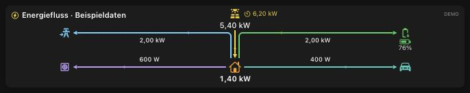
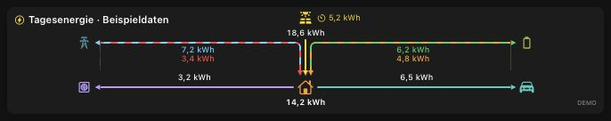

# SMA MQTT Bridge — SMA solar monitoring for MQTT and openHAB

Bring your SMA solar system, battery storage and EV charger into your smart home.
SMA MQTT Bridge collects measurements and device settings from SMA inverters,
Sunny Home Manager 2.0 and SMA eCharger, with optional direct BYD Battery-Box
diagnostics, then publishes them through **Homie 4 MQTT**.
Your smart home can use those values for dashboards, histories and automations;
openHAB can discover the devices through its Homie binding.

Monitor Sunny Tripower and Sunny Boy PV production, Sunny Boy Storage battery
flows, grid import/export and EV charging in one place. The bridge runs locally
in Docker on Linux PCs, servers and ARM64 systems such as a Raspberry Pi.

One Docker service brings the sources together, with optional plant calculations
for household consumption, daily energy balances, charging energy, costs and
feed-in remuneration. The repository also includes ready-to-configure openHAB
widgets for energy monitoring and charging controls.

## What makes it useful

- **Local device access:** inverter readings through Modbus TCP, Home Manager via
  Modbus TCP or UDP, and eCharger via its local API and SEMP. Optional ennexOS
  portal access adds the minimum-PV charging preference without a paid SMA API.
- **Your choice of devices:** enable each source independently and start with only
  the equipment you need. An existing MQTT broker is required.
- **Extensible inverter support:** add verified register mappings as JSON profiles,
  with host overrides, without model-specific adapter code.
- **Customizable display labels:** use bundled English or German labels, override
  individual labels or add another language through a JSON dictionary.
- **Explicit charging controls:** supported eCharger settings can be enabled
  separately from reading measurements. Device-write gates default to disabled;
  Sunny Home Manager remains the charging controller.
- **Docker on multiple architectures:** published images support Linux **amd64**
  and **arm64**. Pull the same image name on either platform.

See the [supported profiles](docs/PROFILES.md), [MQTT value catalog](docs/WERTEKATALOG.md)
and [plant calculations](docs/PLANT.md) for the available data and requirements.

## Supported devices

The repository includes profiles and adapters for the following devices:

| Device | Exact model | Connection |
| --- | --- | --- |
| Sunny Tripower 8.0 | [STP8.0-3AV-40](ressources/profiles/sma-stp8-0-3av-40.json) | Modbus TCP |
| Sunny Boy Storage 3.7 | [SBS3.7-10](ressources/profiles/sma-sbs3-7-10.json) | Modbus TCP |
| Sunny Boy 4.0 | [SB4.0-1AV-41](ressources/profiles/sma-sb4-0-1av-41.json) | Modbus TCP |
| Sunny Home Manager 2.0 | Sunny Home Manager 2.0 | Modbus TCP or UDP meter telegrams |
| BYD Battery-Box Premium HVS | [Four-module HVS profile](docs/BYD.md) | Local diagnostic RTU over TCP |
| SMA eCharger | EVC22-3AC-20 | Local HTTPS API and independently enabled SEMP |

The bundled inverter profiles currently allow firmware **4.10.10.R** for
STP8.0-3AV-40 and SB4.0-1AV-41, and **4.07.31.R** for SBS3.7-10.
Other models or firmware need a matching validated profile; a related model name
alone does not establish compatibility. See the [profile guide](docs/PROFILES.md).

Home Manager transport requirements are covered in the
[Home Manager guide](docs/HOME_MANAGER_MODBUS.md). The eCharger local API verifies
the model and configured serial; parameter units and permissions must match the
metadata. Its model-specific unit fallbacks apply only to firmware **2.6.37.R**.
See [eCharger configuration](docs/CONFIGURATION.md#local-echarger-controls).
The optional ennexOS adapter supplements the charger with its minimum-PV preference;
it is enabled and authenticated separately from local device access.

## Quick start

You need Docker with **Compose 2.24 or newer**, Git, a reachable MQTT broker and at least one
supported SMA source. Enable the required device interface, such as Modbus TCP,
before starting the bridge. The bridge publishes to your broker; it does not
include a broker or its own web dashboard. openHAB is optional.

### 1. Prepare a new installation

```sh
git clone https://github.com/alaub81/sma-mqtt-bridge.git
cd sma-mqtt-bridge
mkdir -p data/sma-mqtt-bridge
touch smab.env
chmod 600 smab.env
```

Keep an existing `smab.env` when updating. Start with the short configuration
below; [smab.example.env](smab.example.env) is the complete optional-settings
reference. No additional JSON configuration is required.

### 2. Configure your broker and devices

Paste this into the new `smab.env` to enable one supported inverter:

```dotenv
SMAB_MQTT_HOST=mqtt.example.invalid
SMAB_INVERTER1_ENABLED=true
SMAB_INVERTER1_HOST=inverter.example.invalid
SMAB_INVERTER1_PROFILE=sma-stp8-0-3av-40
```

Replace both example hostnames with addresses reachable from the container and
choose the profile matching your actual model and firmware. Configure MQTT
credentials if your broker requires them. MQTT defaults to TLS on port 8883 with
certificate verification; configure the CA if your broker uses a private one.
For an intentionally plaintext broker, explicitly set `SMAB_MQTT_TLS=false` and
`SMAB_MQTT_PORT=1883`.

All other sources remain disabled until you enable them. For Home Manager,
eCharger, SEMP and portal settings, use the
[step-by-step setup guide](docs/WIKI_QUICKSTART.md) and
[configuration reference](docs/CONFIGURATION.md).

### 3. Validate and start

```sh
docker compose -f compose.example.yml pull
docker compose -f compose.example.yml run --rm --no-deps sma-mqtt-bridge --check-config
docker compose -f compose.example.yml up -d
docker compose -f compose.example.yml ps sma-mqtt-bridge
docker compose -f compose.example.yml logs --tail=100 sma-mqtt-bridge
```

The configuration check should report `valid: true`, `enabledSources: 1` and
`readOnly: true` for this example. It checks settings and local files; device and
broker connections are verified after startup. A source count of zero means no
device is enabled.

The image is pulled from `ghcr.io/alaub81/sma-mqtt-bridge`. Allow up to two minutes
for initial device reads. Check container health, source availability and MQTT
values using the [operating guide](docs/OPERATIONS.md).
For a pinned image version and safe container replacement, follow
[updates and backups](docs/UPDATING.md). Preserve the `data_smab_state` volume.

## openHAB widgets

The included MainUI widgets cover live energy flow, daily energy totals, DC roof
production, PV forecasts, eCharger controls and charging plans. Select the widgets
you want and connect them to your own Items. Forecast widgets use forecast Items
provided by your setup; the bridge does not generate a weather-based PV forecast.

Start with [openHAB discovery and Item setup](openHAB/openHAB.md), then use the
[widget overview and installation guide](openHAB/README.md). File-based widget
sources and a generated manual import for the eCharger widget are included.

Live energy flow and daily energy overview, captured from the actual openHAB
widgets using their built-in demo mode. All displayed numbers are example data.





## Adapt the bridge to your setup

**Add an inverter profile:** place a verified JSON profile in
`data/sma-mqtt-bridge/profiles/` and select it with `SMAB_INVERTER<N>_PROFILE`.
The [profile guide](docs/PROFILES.md#add-a-custom-inverter-profile) explains
host overrides, identity checks and mapping requirements.

**Choose or add a language:** set `SMAB_LANGUAGE=de` for German discovery labels,
or add a dictionary under `data/sma-mqtt-bridge/translate/`.
The [translation guide](docs/TRANSLATIONS.md) covers overrides and new languages.
Language changes preserve MQTT topic IDs, units and command payloads.

For all supported settings, use [smab.example.env](smab.example.env) and the
[documentation index](docs/README.md). To build your own image, run offline tests
or work on the source, see [building and checks](docs/BUILDING.md).

## Help and feedback

Start with [troubleshooting](docs/OPERATIONS.md#common-setup-problems).
For a reproducible problem or a new device request, open a
[GitHub issue](https://github.com/alaub81/sma-mqtt-bridge/issues).
Include the image version, exact device model/firmware and sanitized error details;
keep passwords, tokens, serials and private configuration out of the report.
Useful [diagnostic and export tools](docs/TOOLS.md) are included.
For security-sensitive reports, follow the [security reporting guide](SECURITY.md).

## License

[MIT](LICENSE). This project is not affiliated with SMA.
